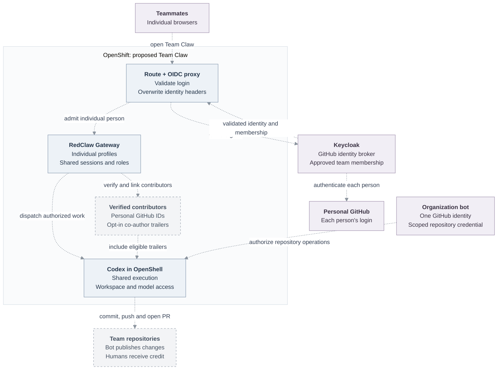

# Proposal: a shared Team Claw on OpenShift

**Status: proposed; awaiting team agreement before deployment.**

## Overview and why this matters

Deploy **RedClaw** as one shared OpenClaw Enterprise (OCE) Agent: one Gateway,
one workspace, one model provider, and one organization-approved GitHub identity
for repository work. Each teammate signs in with their own GitHub account through
Keycloak and receives an individual OpenClaw profile.

We want to collaborate in shared sessions, see who contributed, hand work between
people, mention teammates, and credit contributors on commits. Dogfooding this
setup will expose deployment, authentication, authorization, and collaboration
problems before we recommend it to others. Keep individual personal Agents and
the existing Shelly deployment separate from this trial.

The initial execution choice is **Codex + OpenShell dedicated**. The OpenClaw
Gateway serves the Control UI, profiles, sessions, and routing; Codex executes
agent turns inside an OpenShell sandbox. An OpenClaw Gateway is present even
when the harness is Codex. OCE documentation sometimes calls its Control UI the
“native admin UI”; that term does not select the native OpenClaw harness.
Team identity is a Gateway concern, independent of that harness choice.

## Proposed architecture

Every dashed arrow is a proposed deployment connection or integration to qualify.
The diagram describes the target, not a working deployment.

### Two kinds of GitHub identity

- **System identity:** an organization-approved bot account with access to selected
  repositories. Its credential authorizes cloning, pushing, and PR creation. The
  team must choose the account and credential mechanism; an organization-owned
  GitHub App is an alternative if we qualify the complete publication path.
- **Human identities:** each contributor verifies their own GitHub account. These
  identify participants and provide eligible `Co-authored-by` trailers. A personal
  login is not permission to use the bot credential, and adding a display handle
  is not verification. Teammates do not need to donate personal repository tokens
  merely to receive credit.

OpenClaw documents verified GitHub attribution separately from **My GitHub** and
**System GitHub** repository connections. Co-author credit follows verified
session contributors and their consent; passive viewers are not contributors.
The bot remains the repository publication identity. Exact author/committer and
trailer behavior must be verified with a real commit and PR.

## Login and access

OCE already supports Keycloak for **OCC Console/API human sign-in** through its
OIDC integration. Administrators attach an exact issuer/subject to an existing
OCE account; provider groups, roles, and email do not provision accounts or grant
OCE permissions. The current guarded OIDC profile requires
`agentNativeAdmin.enabled: false`, so it does not provide personal Agent Control UI
access by itself. See [OCE Keycloak sign-in](https://github.com/openclaw/openclaw-enterprise/blob/a7ac7cd37ed0695e8de0bf1d72fec3564c5ad385/docs/guides/deploy/oidc-keycloak.md).

Before implementation, compare extending that existing OCC sign-in path to
principal-bound Gateway access against a separate Team Claw OIDC proxy. Reuse
existing authentication where possible; either choice must resolve the confirmed
Gateway identity and verified GitHub attribution gaps below. The steps here show
the separate-proxy proposal, not an already supported OCE OIDC/launcher combination.

1. Reuse the Keycloak deployment with a separate Team Claw OIDC client. Add a
   GitHub identity provider backed by a team-owned OAuth application.
2. Teammates follow the Route to Keycloak, sign in at GitHub, and return through
   Keycloak to the OIDC proxy. Use exact callback URLs and protected client Secrets.
3. Admit only approved Team Claw members. Successful GitHub login alone is not
   membership. Define explicit membership and administrator assignments in
   Keycloak; preserve an administrator recovery account.
4. Validate issuer, audience, token lifetime, and identity claims at the proxy.
   Choose a stable, issuer-qualified person identifier, and qualify its mapping
   into a durable OpenClaw profile. Keep verified email and immutable GitHub ID
   distinct from editable display names.
5. Assign OpenClaw member and administrator roles explicitly. Members can create
   and collaborate in shared sessions; selected administrators manage Gateway
   configuration and model settings. Kubernetes cluster-admin membership does not
   automatically determine the OpenClaw role.
6. Test logout and membership removal for both new and existing WebSockets.
   Specify session expiry and revocation behavior before admitting the team.

One Gateway is one shared tool-authority boundary. Profiles, ownership, and
presence enable collaboration; they do not isolate mutually untrusted users.
Ordinary team sessions should be shared. OpenClaw also supports draft/private
sharing states: decide whether these are acceptable rather than promising that
members can enter every session regardless of its sharing policy.

Visitor Access is unnecessary for this initial setup. It manages expiring guest
grants through Cloudflare Access, not permanent Keycloak team membership.

## Why the current UI shows one identity

OCE users and Agent service principals have their own identities and IAM grants.
The identity loss occurs at the OpenClaw Gateway access boundary, not because OCE
or OpenShell has no user model.

OCE's Kubernetes Compute Driver requires the `x-occ-identity` header and the
`occ-workspace-files` principal, gives that principal `operator.admin`, and sets
it on operator Gateway routes. The name reflects its machine use for workspace
operations. OCE's Agent admin UI (called the native admin UI in its reference) reuses that identity after
checking the human's OCE access. Our OpenShift OAuth proxy likewise replaces
all browser identities with it. The Gateway therefore cannot distinguish those
people even though the outer application authenticated them separately.

This is **not OpenShell-specific or an inherent Codex limitation**. The shared
Kubernetes configuration path runs for embedded OpenClaw, dedicated Codex, and
dedicated OpenClaw revisions. OpenShell controls execution and credential delivery;
it does not choose this browser principal. This finding does not imply that every
standalone Codex deployment or every OCE Compute Driver behaves identically.

OpenClaw already documents personal Gateway profiles and turn attribution. We
should reuse those mechanisms and verify their delivery into the selected harness,
not assume that a new Gateway-to-harness identity protocol is required.

## Existing OpenClaw identity propagation

OpenClaw already resolves an authenticated person to a durable Gateway profile.
Chat admission captures that person's operator authority, and dispatch carries it
into execution and tool authorization. Codex's prompt construction includes the
session's eligible Git co-author instructions. This is per-request human context;
it does not require one Codex process, model credential, or Linux user per person.
The exact OCE-pinned runtime still needs live qualification.

For trusted plugin transports, OpenClaw also documents
[principal-bound remote ingress](https://docs.openclaw.ai/plugins/sdk-gateway-ingress).
It binds UI and RPC access to one existing person and a live delegation grant.
The current person path requires trusted Cloudflare Access profiles and role
configuration; it is not an arbitrary profile-ID header or a ready-made Keycloak
adapter. Evaluate this existing contract before designing any new ingress API.

## Confirmed gaps and qualification work

| Area | Current evidence | Required before full deployment |
| --- | --- | --- |
| OCE human Gateway identity | Kubernetes Compute permits only the shared principal and admin scope. | Extend the Compute/authentication contract for an operator-approved human identity path; retain separate OCC machine access. |
| Browser routing | Both the Kubernetes operator route and our OpenShift proxy overwrite identity with a constant. | Add an authenticated per-person ingress path; prevent browser spoofing and direct bypass. Keep machine routes separate. |
| OCE Agent admin launcher | Its support predicate requires the shared admin identity and admin device auto-approval. | Define a separate member collaboration surface or extend this contract. Do not expose the existing admin launcher as a member interface. |
| Roles and lifecycle | Existing access checks authorize OCE operations; they do not establish per-person OpenClaw roles. | Define membership/role provisioning, persistence across redeploys, recovery, and revocation. Keep OCE IAM, Keycloak roles, and OpenClaw roles distinct. |
| Verified GitHub co-authorship | OpenClaw documents GitHub enrichment through Cloudflare Access or Tailscale. A generic proxy cannot assert a verified GitHub account. | Qualify an existing supported identity-linking path or implement a reviewed Keycloak/OIDC integration in OpenClaw. Do not spoof Cloudflare headers or accept pasted handles as proof. This gap extends beyond OCE. |
| Shared repository credential | No Team Claw bot credential or publication proof exists. | Select the bot/App, scope repository permissions, configure credential delivery and egress, and prove clone/push/PR without exposing its token. |
| Exact runtime support | Today's OpenClaw docs can describe features newer than OCE's pinned runtime. | Freeze compatible OCE/OpenClaw commits and image digests; verify profiles, roles, attribution, and harness behavior on those images. |

OCE product changes belong upstream in OCE, through its existing Driver and
lifecycle contracts. This repository owns deployment manifests and recipes.
OpenClaw identity-enrichment changes, if necessary, belong upstream in OpenClaw.

## Delivery and acceptance

1. Agree on this proposal, membership policy, administrators, system GitHub
   identity, repositories, model, and session-sharing defaults.
2. Resolve the OCE and OpenClaw design gaps in separate changes with integration
   proof. Preserve the existing single-Agent machine path.
3. Add reproducible Keycloak, proxy, Route, and Agent inputs here. Keep credentials
   and rendered private inputs outside Git. Deploy RedClaw separately from Shelly.
4. Test with two distinct human logins: separate profiles, presence, mentions,
   shared-session participation and attribution; deny an unapproved third login.
5. Verify members cannot change protected Gateway/model settings or obtain admin
   scopes by changing browser headers, reconnecting, or choosing another profile.
6. Produce a real repository change using the bot, with verified, consenting human
   co-author trailers. Check the resulting commit and PR independently.
7. Verify restart/redeploy retention, member removal and active-connection handling,
   credential isolation, workspace access, and a real model turn. Publish the
   tested recipe and its limits only after these pass.

## Evidence and references

Reviewed OCE `a7ac7cd37` and local OpenClaw `95d09cc0b`; deployment compatibility is
not established by this document. No cluster changes are part of this proposal.

- [OpenClaw team setup](https://docs.openclaw.ai/start/teams) and [multi-user mode](https://docs.openclaw.ai/concepts/multi-user).
- [Profiles, GitHub verification and co-author credit](https://docs.openclaw.ai/concepts/user-model).
- [Keycloak GitHub identity-provider setup](https://github.com/keycloak/keycloak/blob/main/docs/documentation/server_admin/topics/identity-broker/social/github.adoc).
- [OCE's documented shared Gateway authority](https://github.com/openclaw/openclaw-enterprise/blob/a7ac7cd37ed0695e8de0bf1d72fec3564c5ad385/docs/reference/agent-native-admin.md#native-authority-and-drift).
- [Kubernetes preparation and enforced Gateway configuration](https://github.com/openclaw/openclaw-enterprise/blob/a7ac7cd37ed0695e8de0bf1d72fec3564c5ad385/apps/controller/src/drivers/compute/kubernetes/index.ts#L5169).
- [Current OpenShift proxy](../manifests/openshift/base/control-ui/control-ui-oauth-proxy.yaml).
